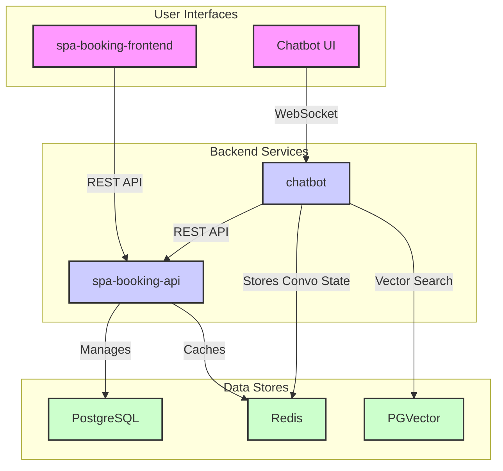

# AI Massage Booking Project

This project is a sophisticated web application that allows users to book massage appointments through a standard web interface or a conversational AI chatbot.

## Key Systems

The project is composed of three main systems:

- [[spa-booking-frontend]]: A Next.js single-page application that provides the user interface for booking and managing appointments.
- [[spa-booking-api]]: A FastAPI backend that exposes a REST API for all booking-related operations. It is the single source of truth for all data.
- [[chatbot]]: A Python-based conversational AI that allows users to book appointments through a chat interface. It uses a combination of NLU, dialogue management, and external tools to fulfill user requests.

## High-Level Architecture

See [[docs/01-system-architecture.md]] for a more detailed breakdown of each system.
