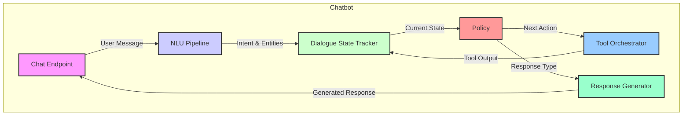

# System Architecture

This document provides a more detailed look at the architecture of each system.

## [[spa-booking-frontend]]

The `spa-booking-frontend` is a Next.js application responsible for all user-facing interactions.

- **Responsibilities**:
  - Provides a web interface for booking and managing appointments.
  - Communicates with the `spa-booking-api` to fetch and mutate data.
  - Integrates the chatbot interface.
- **Key Technologies**: Next.js, React, Tailwind CSS, Socket.IO.

## [[spa-booking-api]]

The `spa-booking-api` is the central backend service.

- **Responsibilities**:
  - Exposes a REST API for all booking operations (creating, updating, canceling, etc.).
  - Manages the PostgreSQL database, which stores all core business data.
  - Uses Redis for caching and session management.
  - Authenticates users and manages user sessions.
  - Contains all core business logic for booking.
- **Key Technologies**: FastAPI, SQLAlchemy, Redis, PostgreSQL.
- **Authentication**: Authentication is handled via JWT tokens. The `spa-booking-api` issues tokens upon successful login, and these tokens are required for all subsequent API requests.

## [[chatbot]]

The `chatbot` is a Python application that provides a conversational interface for booking appointments.

- **Responsibilities**:
  - Manages the WebSocket connection with the chatbot UI.
  - Orchestrates the entire conversational flow.
  - Uses NLU (Natural Language Understanding) to extract intents and entities from user messages.
  - Manages the dialogue state, including slot filling and context tracking.
  - Integrates with the `spa-booking-api` via a client gateway to perform booking-related actions.
  - Uses a PGVector store for knowledge base lookups (e.g., for answering FAQ questions).
  - Uses Redis to store conversation session state.
- **Key Technologies**: Python, Transformers, LangChain, PGVector, Redis.

### Chatbot Internal Architecture

- **[[chatbot/app/chat_endpoint.py]]**: The main entry point for the chatbot, handling WebSocket connections and message passing.
- **[[chatbot/nlu/nlu.py]]**: The NLU pipeline, which includes intent classification and entity extraction.
- **[[chatbot/conversation/dialogue_state_tracker.py]]**: Manages the state of the conversation, including all slots and context.
- **[[chatbot/conversation/policy.py]]**: Decides the next action to take based on the current dialogue state.
- **[[chatbot/tools/registry.py]]**: A registry of all available tools that the chatbot can use to interact with the outside world (e.g., to call the `spa-booking-api`).
- **[[chatbot/conversation/response_generator.py]]**: Generates the final response to send to the user.
