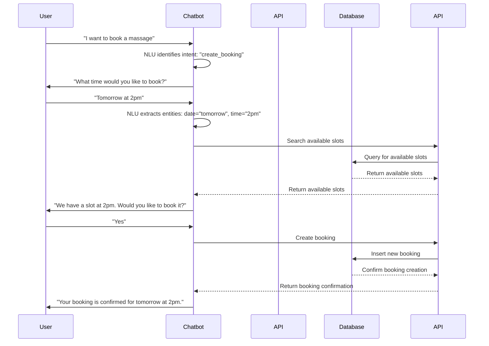

# Booking Flow

This document describes the flow of a normal booking request through the system.

## Step-by-Step Breakdown

1.  **User Initiates Booking**: The user sends a message to the chatbot indicating they want to book a massage.
2.  **Intent and Entity Extraction**: The [[chatbot/nlu/nlu.py]] pipeline processes the message, identifies the `create_booking` intent, and starts to fill the required slots (e.g., `date`, `time`, `duration`).
3.  **Slot Filling**: The chatbot continues to ask the user for any missing information until all required slots for the booking are filled.
4.  **Check Availability**: Once all slots are filled, the chatbot, through its [[chatbot/tools/search_tools.py]], calls the `spa-booking-api` to check for available slots.
5.  **API Fetches Data**: The `spa-booking-api` queries the PostgreSQL database to find available slots that match the user's request.
6.  **User Confirmation**: The chatbot presents the available options to the user and asks for confirmation.
7.  **Create Booking**: Upon confirmation, the chatbot, through its [[chatbot/tools/write_tools.py]], calls the `spa-booking-api` to create the booking.
8.  **API Creates Booking**: The `spa-booking-api` validates the request, creates the booking in the PostgreSQL database, and returns a confirmation to the chatbot.
9.  **Booking Confirmation**: The chatbot informs the user that their booking is confirmed.
