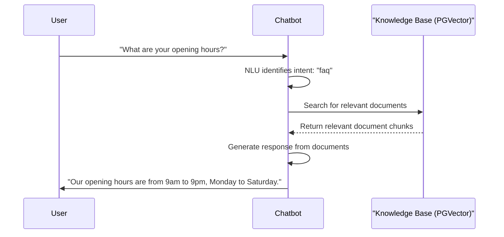

# FAQ Flow

This document describes how the system handles a general question or FAQ.

## Step-by-Step Breakdown

1.  **User Asks Question**: The user asks a general question, such as "What are your opening hours?".
2.  **Intent Identification**: The [[chatbot/nlu/intent_classifier.py]] identifies the intent as `faq` or `chitchat`.
3.  **Knowledge Base Search**: The [[chatbot/knowledge/knowledge_service.py]] takes the user's query and performs a vector search against the PGVector database to find the most relevant document chunks. These documents are ingested and indexed from Markdown files using [[chatbot/scripts/ingest.py]].
4.  **Response Generation**: The [[chatbot/conversation/response_generator.py]] uses the retrieved document chunks as context for a large language model (LLM) to generate a natural language response.
5.  **Send Response**: The chatbot sends the generated response back to the user.
