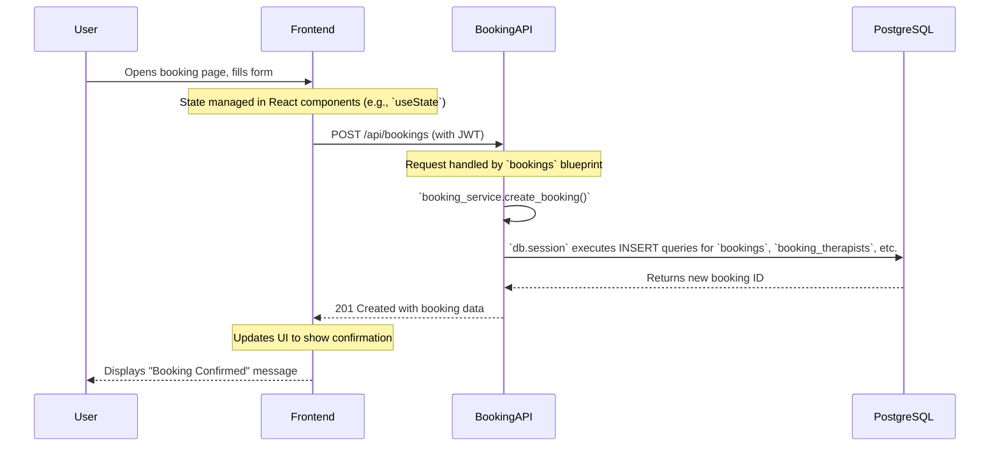
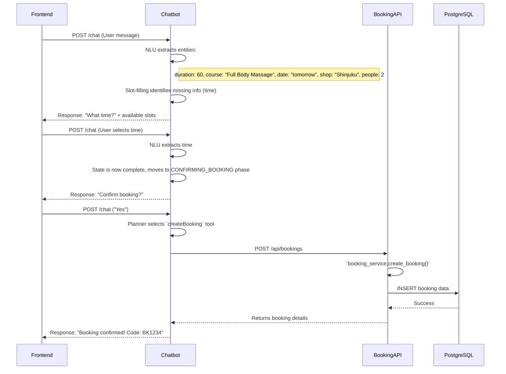

# 6. Full System Architecture

This document outlines the complete end-to-end architecture of the AI Massage Booking application, showing how the `spa-booking-frontend`, `chatbot`, and `spa-booking-api` systems work together.

## System Communication Diagram

This diagram illustrates the primary communication paths between the three main systems. The user interacts only with the frontend, which then communicates with the appropriate backend system based on the action.

```mermaid
graph TD
    subgraph User Browser
        A[spa-booking-frontend]
    end

    subgraph Backend Services
        B[spa-booking-api]
        C[chatbot]
    end

    subgraph Database
        D[PostgreSQL]
    end

    A -- "1. Normal Booking (REST)" --> B
    A -- "2. Chat Message (REST)" --> C

    C -- "3. Tool Calls (REST)" --> B

    B -- "4. Data Access (SQL)" --> D

    style A fill:#D6EAF8,stroke:#3498DB
    style B fill:#D1F2EB,stroke:#1ABC9C
    style C fill:#FDEDEC,stroke:#E74C3C
    style D fill:#FAD7A0,stroke:#F39C12
end
```

### Communication Trace

1.  **Frontend → Booking API**: For standard UI-driven actions (e.g., clicking "Book Now" on a form), the frontend makes direct REST calls to the Booking API.
    -   **Source**: [[spa-booking-frontend/lib/api.ts]]
    -   **Target**: `http://localhost:5001/api/*`
    -   **Authentication**: A JWT `access_token` from `localStorage` is sent in the `Authorization: Bearer` header.

2.  **Frontend → Chatbot**: When a user interacts with the chat widget, the frontend sends the message to the chatbot backend.
    -   **Source**: [[spa-booking-frontend/lib/hooks/useChat.ts]]
    -   **Target**: `POST http://localhost:8000/chat`
    -   **State**: A `session_id` is generated and maintained by the frontend (`useChat` hook) to track the conversation.

3.  **Chatbot → Booking API**: When the chatbot needs to perform an action (e.g., check availability, create a booking), it uses "tools" that make REST calls to the Booking API.
    -   **Source**: [[chatbot/tools/search_tools.py]], [[chatbot/tools/write_tools.py]] via [[chatbot/gateway/client.py]]
    -   **Target**: `http://localhost:5001/api/*`
    -   **Authentication**: The chatbot does not currently pass authentication information to the Booking API. It acts as a public, unauthenticated client.

4.  **Booking API → PostgreSQL**: The Booking API is the only system that directly accesses the PostgreSQL database.
    -   **Source**: [[spa-booking-api/app/services]] (e.g., `booking_service.py`) and [[spa-booking-api/app/blueprints]].
    -   **Mechanism**: The API uses `SQLAlchemy` via the `db.session` object defined in [[spa-booking-api/app/extensions.py]].

---

## SCENARIO 1: NORMAL BOOKING

A user creates a booking using the standard web interface.



**Trace Path:**

1.  **Page**: [[spa-booking-frontend/app/booking/page.tsx]]
2.  **Component**: The booking form component gathers user input.
3.  **Frontend State**: Local component state holds the booking details (date, time, courses).
4.  **API Request**: The `api.bookings.create()` function in [[spa-booking-frontend/lib/api.ts]] sends a `POST` to `/api/bookings`. The `authFetch` helper adds the JWT token.
5.  **Booking API Route**: The request is routed to the `create_booking` function in [[spa-booking-api/app/blueprints/bookings.py]].
6.  **Service**: The blueprint calls `create_booking` in [[spa-booking-api/app/services/booking_service.py]].
7.  **Model/Database**: The service function uses SQLAlchemy models and `db.session` to create new rows in the `bookings`, `booking_services`, and `booking_therapists` tables within a database transaction.
8.  **API Response**: The API returns a JSON object of the newly created booking.
9.  **Frontend State/UI**: The frontend receives the response and updates its state, navigating the user to a confirmation page or displaying a success message.

---

## SCENARIO 2: CHATBOT BOOKING

User types: *"Book a 60 minute Full Body Massage tomorrow at Shinjuku for 2 people."*



**Trace Path:**

1.  **Frontend**: [[spa-booking-frontend/components/chatbot/ChatWindow.tsx]] captures the input.
2.  **`useChat` Hook**: [[spa-booking-frontend/lib/hooks/useChat.ts]] sends the message via `api.chat.sendMessage`.
3.  **Chatbot HTTP Endpoint**: [[chatbot/app/main.py]] receives the `POST /chat` request.
4.  **Session/State**: The system loads or creates a `ConversationState` for the `session_id`.
5.  **NLU**: [[chatbot/nlu/nlu_pipeline.py]] processes the text.
    -   **Intent**: `book_massage`
    -   **Entities**: `duration: 60`, `course_name: "Full Body Massage"`, `date: <tomorrow>`, `shop_name: "Shinjuku"`, `num_people: 2`.
6.  **Conversation State**: [[chatbot/conversation/slot_filling.py]] updates the `BookingContext` with these entities. It sees that `startTime` is missing.
7.  **Policy**: [[chatbot/conversation/policy.py]] decides the next action is to ask for the time (`A_RequestTime`).
8.  **Planner/Tool**: The policy may decide to call `searchAvailableSlots` tool from [[chatbot/tools/search_tools.py]] to fetch available times to show the user.
9.  **Booking API**: The tool calls `GET /api/shops/{id}/available-slots`.
10. **Chatbot Response**: The chatbot returns a message asking for the time, possibly with a list of suggestions.
11. **Frontend**: The user selects a time, and the process repeats.
12. **Final Confirmation**: Once all slots are filled, the policy moves to `CONFIRMING_BOOKING` phase. When the user confirms, the policy selects the `createBooking` tool.
13. **`createBooking` Tool**: [[chatbot/tools/write_tools.py]] calls `POST /api/bookings`.
14. **Database -> UI**: The rest of the flow follows the API and database path from Scenario 1, with the final response being relayed back through the chatbot to the frontend.

---

## SCENARIO 3: FAQ

User types: *"What are your opening hours?"*

**Trace Path:**

1.  **Frontend → Chatbot**: The message is sent to `POST /chat` as in the booking scenario.
2.  **NLU**: The [[chatbot/nlu/nlu_pipeline.py]] classifies the intent as `faq` instead of `book_massage`. The entity `opening hours` is extracted.
3.  **Policy/Planner**: The `FaqPolicy` in [[chatbot/conversation/policy.py]] takes over. It sees the `faq` intent and decides to use the `faqSearch` tool, not the booking tools.
4.  **Knowledge Search**: The `faqSearch` tool in [[chatbot/tools/search_tools.py]] calls the `KnowledgeService`. This service performs a vector search over the content in `docs/knowledge/faq.md` (or a similar indexed source).
5.  **Response**: The tool finds the most relevant text snippet about opening hours.
6.  **Chatbot → Frontend**: The chatbot formats the snippet into a user-friendly message and sends it back.

This flow **does not enter the booking flow** because the initial NLU intent classification routes the conversation down a different path managed by a specific FAQ policy, which uses a non-API, internal knowledge tool.

---

## SCENARIO 4: AUTHENTICATION

**Trace Path:**

1.  **Login Page**: The user enters credentials into [[spa-booking-frontend/app/login/page.tsx]].
2.  **`AuthContext`**: The page calls the `login` function from [[spa-booking-frontend/contexts/AuthContext.tsx]].
3.  **Authentication Endpoint**: The context function calls `api.auth.login` from [[spa-booking-frontend/lib/api.ts]], which sends a `POST` to `/api/auth/login`.
4.  **Backend Verification**: The request is handled by [[spa-booking-api/app/blueprints/auth.py]]. It finds the user by username and verifies the password using `bcrypt.check_password_hash`.
5.  **Token Generation**: Upon success, it creates a JWT using `create_access_token` from `flask_jwt_extended`, including the user's `id` and `role` in the token's identity.
6.  **Frontend Auth State**: The `AuthContext` receives the `access_token` and user object. It stores them in both its React state and the browser's `localStorage`.
7.  **Authenticated Request**: For subsequent API calls (e.g., fetching bookings), the `authFetch` helper in `lib/api.ts` reads the token from `localStorage` and adds it to the `Authorization: Bearer <token>` header. The Booking API uses the `@jwt_required()` decorator to protect endpoints.

### Role Differences:

-   **Customer**: Does not log in. They are identified by their phone number when making a booking.
-   **Therapist & Admin**: Log in through the `/login` page. Their `role` (`therapist` or `admin`) is embedded in the JWT. The API backend uses this role to authorize access to specific blueprints and endpoints (e.g., an Admin can access `/api/admin/bookings`, but a Therapist cannot).

---

## SCENARIO 5: ADMIN BOOKING MANAGEMENT

**Trace Path:**

1.  **Frontend**: An admin user navigates to the admin dashboard at [[spa-booking-frontend/app/admin/bookings/page.tsx]].
2.  **API Request**: The page component makes a request using `api.admin.getBookings()` from [[spa-booking-frontend/lib/api.ts]]. This function adds the admin's JWT to the header.
3.  **Authentication/Authorization**: The request hits `GET /api/admin/bookings`. The endpoint is in [[spa-booking-api/app/blueprints/admin/bookings.py]] and is protected by a decorator that checks for a valid JWT with the `admin` role.
4.  **Blueprint**: The blueprint function may apply filters from query parameters.
5.  **Service**: It calls a service function like `booking_service.get_all_bookings()`.
6.  **Database**: The service function queries the PostgreSQL database via `db.session`, joining `Booking`, `Shop`, `Customer`, and other tables.
7.  **Response**: The service returns a list of booking objects, which the blueprint serializes into JSON and sends back to the frontend.
8.  **UI**: The frontend receives the list of bookings and renders them in a table or dashboard view.
