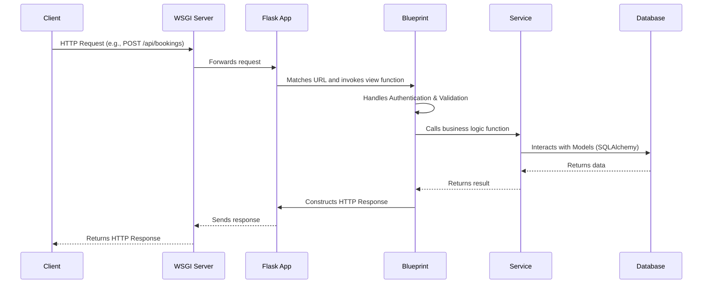

# API Architecture

This document describes the architecture of the `spa-booking-api` system, from the outside in.

## Entry Point & Application Factory

The application is a standard Flask project.

-   **Entry Point**: [[spa-booking-api/run.py]] is the main executable. It loads environment variables using `dotenv` and then calls the application factory `create_app`.
-   **Application Factory**: The `create_app` function in [[spa-booking-api/app/__init__.py]] is the core of the application setup.

The factory pattern (`create_app`) allows for creating different app instances for different environments (e.g., development, testing, production) by loading different configurations.

```mermaid
graph TD
    A[run.py] --> B{create_app() in __init__.py};
    B --> C{Flask App Instance};
    C --> D[Initialize Extensions];
    C --> E[Register Blueprints];
    C --> F[Register Error Handlers];
    C --> G[Return App Instance];
```

## How an HTTP Request Enters the API

1.  A request from a client (like the Next.js frontend or the Python chatbot) hits the server running the Flask application (e.g., Gunicorn in production).
2.  The request is routed by the WSGI server to the Flask application object created by `create_app`.
3.  Flask then matches the request's URL path to the appropriate **Blueprint** based on the prefixes defined in `[[spa-booking-api/app/__init__.py]]`.

## Request Lifecycle Overview



## Extensions

The [[spa-booking-api/app/__init__.py]] file initializes several key Flask extensions which are defined in [[spa-booking-api/app/extensions.py]]:

-   **`db` (`SQLAlchemy`)**: The Object-Relational Mapper (ORM) for database interaction.
-   **`migrate` (`Flask-Migrate`)**: Handles database schema migrations.
-   **`jwt` (`Flask-JWT-Extended`)**: Manages JSON Web Token (JWT) based authentication.
-   **`socketio` (`Flask-SocketIO`)**: For WebSocket communication (though its usage seems minimal in the core booking flow).
-   **`cors` (`Flask-Cors`)**: Manages Cross-Origin Resource Sharing to allow the frontend to call the API.
-   **`redis_client`**: A Redis client for caching or other purposes.
