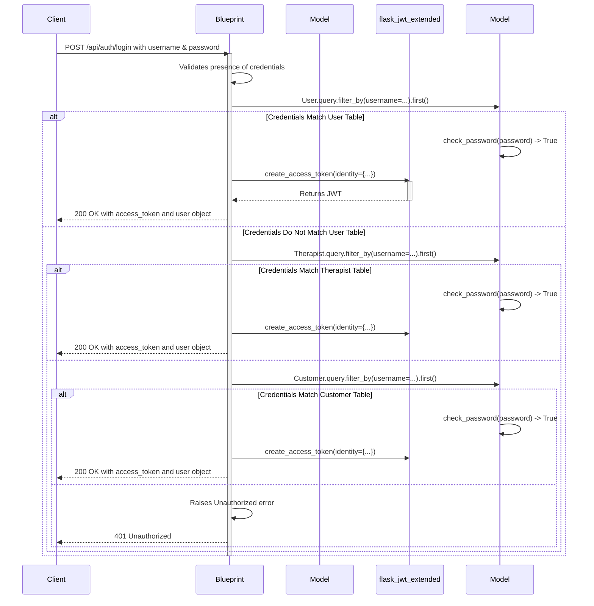
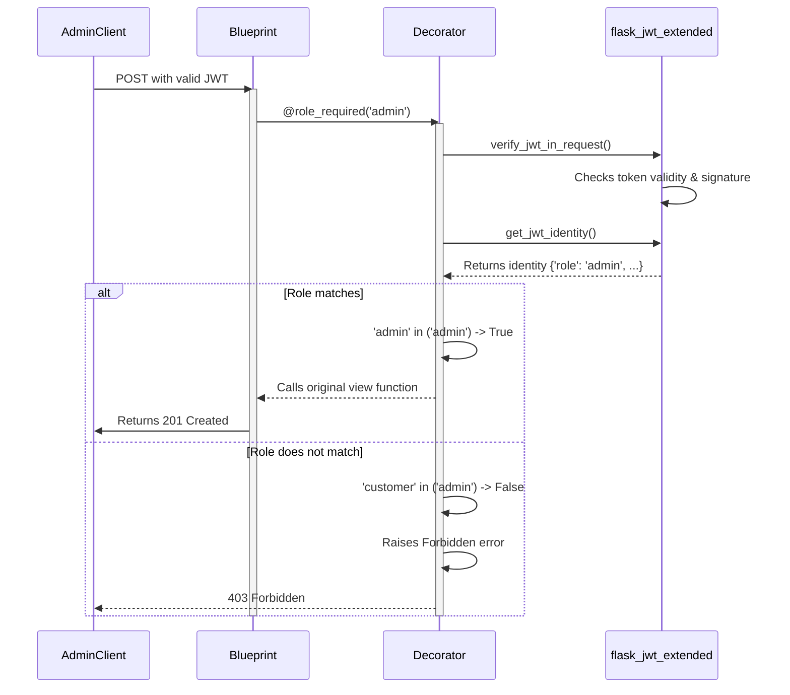

# API Authentication

Authentication in the `spa-booking-api` is handled via JSON Web Tokens (JWT), managed by the `Flask-JWT-Extended` library.

## Flow 4: Authentication

This flow details how a user (admin, therapist, or customer) logs in and receives a token for accessing protected endpoints.

**Endpoint**: `POST /api/auth/login`

### Trace

### File Involvement & Logic

1.  **[[spa-booking-api/app/blueprints/auth/__init__.py]]**:
    -   **Role**: Defines the `/login` route and contains all authentication logic.
    -   **Function**: `login()`
    -   **Logic**:
        -   It receives the `username` and `password` from the request JSON.
        -   It attempts to authenticate the user in a specific order of roles: **Admin (`User` model), then `Therapist`, then `Customer`**.
        -   For each role, it queries the corresponding database table to find the user by `username`.
        -   If a user is found, it calls the `check_password` method on the model instance.

2.  **[[spa-booking-api/app/models/user.py]]** (and similar logic in `therapist.py` and `customer.py`):
    -   **Role**: Defines the user data model and password handling.
    -   **Function**: `check_password(password)`
    -   **Logic**: It uses `check_password_hash` from `werkzeug.security` to compare the provided plaintext password against the stored hash. This prevents storing plaintext passwords.

3.  **`flask_jwt_extended`**:
    -   **Role**: A library that generates and verifies JWTs.
    -   **Function**: `create_access_token(identity)`
    -   **Logic**: When `check_password` returns `True`, the `login` function calls this to create a new JWT. The `identity` payload is a dictionary containing crucial information like `user_id` and `role`, which will be used to authorize subsequent requests.

## Authenticated Requests

For endpoints that require authentication, the client must include the JWT in the `Authorization` header:

`Authorization: Bearer <access_token>`

The `Flask-JWT-Extended` library automatically inspects this header. Protected routes are decorated with `@jwt_required()`. This decorator ensures that only requests with a valid, non-expired JWT are allowed. The identity payload can be accessed within the protected route to identify the user and check their role.

## Flow 5: Admin Authorization

Admin requests are not fundamentally different from other authenticated requests, but they are protected by an additional layer of role-based access control (RBAC).

**Example Endpoint**: `POST /api/admin/shops`

### Trace

### File Involvement & Logic

1.  **[[spa-booking-api/app/blueprints/admin/shops.py]]**:
    -   **Role**: Defines admin-only CRUD operations for a resource.
    -   **Usage**: Every route is decorated with `@role_required('admin')`.

2.  **[[spa-booking-api/app/utils/decorators.py]]**:
    -   **Role**: Provides the custom decorator for checking user roles.
    -   **Function**: `role_required(*roles)`
    -   **Logic**:
        1.  It's a factory that creates a decorator.
        2.  The decorator it creates first calls `verify_jwt_in_request()` to ensure the user is logged in (Authentication).
        3.  It then calls `get_jwt_identity()` to get the payload from the token.
        4.  Finally, it checks if the `role` from the identity is present in the list of roles allowed for this endpoint (Authorization).
        5.  If not, it raises a `403 Forbidden` error, stopping the request before it reaches the view function's logic.
