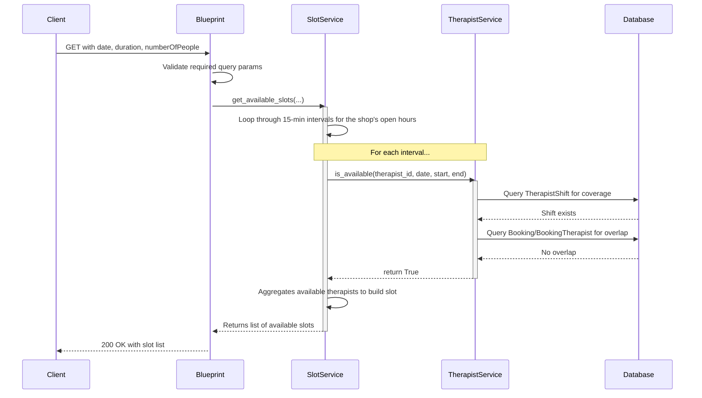
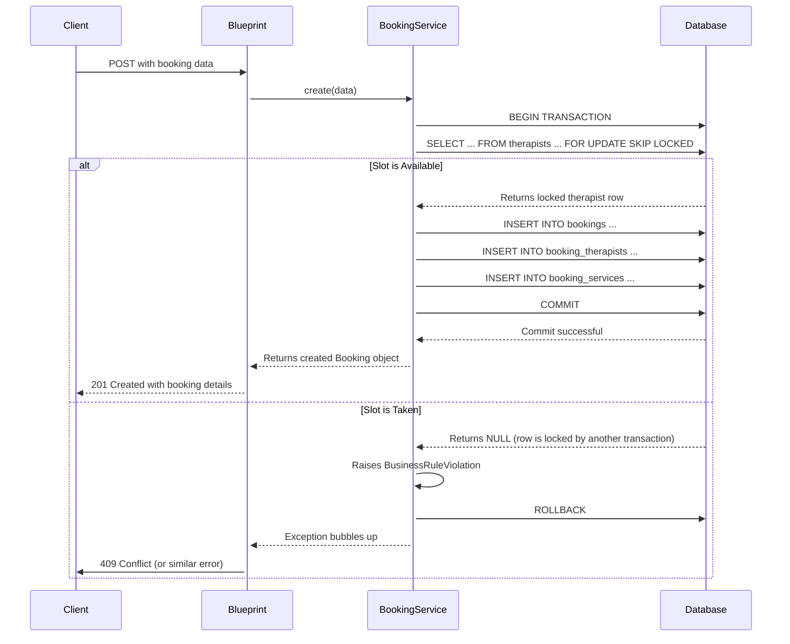

# API Booking and Availability Flow

This document explains the more complex flows related to checking availability and creating bookings.

## Flow 2: Search Available Slots

This flow is central to the entire application. It determines which time slots are available for booking based on multiple factors.

**Endpoint**: `GET /api/shops/<shop_id>/available-slots`

### Trace

### File Involvement & Logic

The actual availability logic is distributed across two services:

1.  **[[spa-booking-api/app/blueprints/public/slots.py]]**:
    -   **Role**: The entry point. Defines the route, parses and validates query parameters (`date`, `duration`, `numberOfPeople`).
    -   **Calls**: `SlotService.get_available_slots`.

2.  **[[spa-booking-api/app/services/slot_service.py]]**:
    -   **Role**: Orchestrates the search. It doesn't decide availability itself but generates potential slots and asks for their status.
    -   **Function**: `get_available_slots()`
    -   **Logic**:
        -   It fetches the shop's opening and closing times.
        -   It iterates from `open_time` to `close_time` in increments of `SLOT_INTERVAL` (15 minutes).
        -   In each iteration, it creates a potential `startTime` and `endTime`.
        -   It then calls `TherapistService` to determine how many therapists are available for that specific time window.
    -   **Calls**: `TherapistService.is_available` (if `show_therapists` is true) or `TherapistService.count_available_capacity`.

3.  **[[spa-booking-api/app/services/therapist_service.py]]**:
    -   **Role**: Contains the **actual business logic** for determining if a single therapist is available.
    -   **Function**: `is_available(therapist_id, date, start_time, end_time)`
    -   **Logic**: A therapist is considered available if and only if **both** of these conditions are true:
        1.  **Shift Coverage**: The therapist has a registered shift that completely contains the requested time window (`start_time` to `end_time`). This is checked by querying the `therapist_shifts` table via the `TherapistShift` model.
        2.  **No Overlapping Bookings**: The therapist is not assigned to any other booking that is `Booked` or `CheckedIn` and overlaps with the requested time window. This is checked by querying the `bookings` and `booking_therapists` tables.

This separation makes `TherapistService.is_available` the single source of truth for therapist availability, which can be reused by different orchestrators like `SlotService`.

## Flow 3: Create Booking

This flow creates a new booking record in the database. It's a critical, transactional operation that ensures data integrity and prevents double-booking.

**Endpoint**: `POST /api/bookings`

### Trace

### File Involvement & Logic

1.  **[[spa-booking-api/app/blueprints/bookings/routes.py]]**:
    -   **Role**: Defines the `POST /api/bookings` endpoint.
    -   **Function**: `create_booking()`
    -   **Logic**: It gets the JSON payload from the request and passes it directly to `BookingService.create`. It then formats the successful response.

2.  **[[spa-booking-api/app/services/booking_service.py]]**:
    -   **Role**: Implements the entire business logic for creating a booking within a single database transaction.
    -   **Function**: `create(data)`
    -   **Key Logic**:
        1.  **Validation**: Checks for required fields and verifies the customer is not blocked.
        2.  **Therapist Locking (Reservation Logic)**: This is the most critical step for preventing race conditions.
            - When a specific therapist is requested, the code executes a `SELECT ... FOR UPDATE SKIP LOCKED` query on the `therapists` table.
            - `FOR UPDATE` tells PostgreSQL to place a row-level lock on the selected therapist.
            - `SKIP LOCKED` is the key: if another transaction has already locked that therapist row, this query will not wait. Instead, it will immediately return nothing.
            - `BookingService` interprets this empty result as "the slot was just taken" and raises a `BusinessRuleViolation('SLOT_UNAVAILABLE')`.
            - This effectively creates a very short-lived, atomic reservation for the therapist at the exact moment of booking creation.
        3.  **Data Creation**: If the lock is successful, it proceeds to create the `Booking`, `BookingTherapist`, and other related records.
        4.  **Transaction Management**: The entire method is wrapped in a `try...except` block. If any error occurs (including the `SLOT_UNAVAILABLE` violation), `db.session.rollback()` is called to abort the transaction, ensuring the database is left in a consistent state. If all steps succeed, `db.session.commit()` is called.
