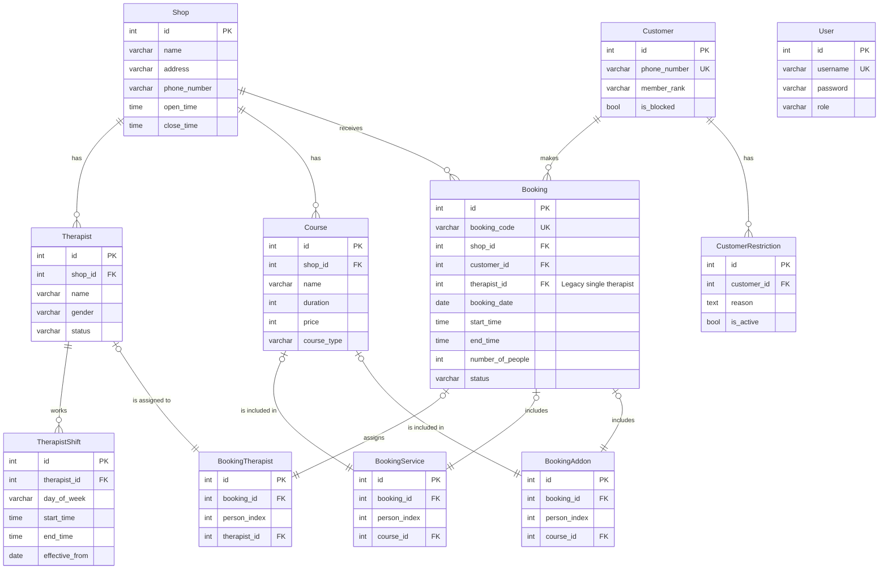

# API Database and Models

This document outlines the database schema, models, and their relationships. The API uses Flask-SQLAlchemy to interact with a PostgreSQL database.

## How Models Represent Data

Each Python class in [[spa-booking-api/app/models/]] corresponds to a table in the database. These classes define the columns as attributes and use `db.relationship` to define how tables are linked.

## Entity-Relationship Diagram (ERD)

## Key Models and Relationships

-   **[[spa-booking-api/app/models/shop.py]]**: The central entity for a physical location. It has one-to-many relationships with `Therapist`, `Course`, and `Booking`.

-   **[[spa-booking-api/app/models/therapist.py]]**: An employee who performs services. Belongs to exactly one `Shop`.
    -   `shifts`: A one-to-many relationship with **[[spa-booking-api/app/models/therapist_shift.py]]**, which defines their weekly work schedule. This is critical for calculating availability.

-   **[[spa-booking-api/app/models/customer.py]]**: A person who makes bookings. Identified by a unique `phone_number`.
    -   `restrictions`: A one-to-many relationship with **[[spa-booking-api/app/models/customer_restriction.py]]**, which implements the "NG List" (blocklist).

-   **[[spa-booking-api/app/models/booking.py]]**: The core transactional model. This file defines **four** distinct but related models:
    -   **`Booking`**: The main record of an appointment. It links the `Shop`, `Customer`, `date`, and `time`.
    -   **`BookingTherapist`**: An association table that links a `Booking` to a `Therapist`. It includes a `person_index` to handle group bookings where multiple therapists are assigned to one booking record. This is the modern way therapists are assigned. The `therapist_id` on `Booking` itself is for legacy or single-person bookings.
    -   **`BookingService`**: An association table linking a `Booking` to a main `Course` for a specific person (`person_index`).
    -   **`BookingAddon`**: An association table linking a `Booking` to an addon `Course` for a specific person.

-   **[[spa-booking-api/app/models/user.py]]**: Represents an administrative user with login credentials. Distinct from a `Customer`. The `role` column determines their permissions.

## How Transactions Work

SQLAlchemy sessions provide transaction demarcation. In the services, particularly [[spa-booking-api/app/services/booking_service.py]], the flow is:

1.  The service method begins its work.
2.  It issues queries to the database.
3.  When a write operation is performed (`db.session.add(obj)`), the change is pending in the session.
4.  If the entire operation is successful, `db.session.commit()` is called. This writes all pending changes to the database in an atomic `COMMIT`.
5.  If any error occurs, `db.session.rollback()` is called. This discards all pending changes, ensuring the database is not left in a partially updated state. This is crucial for the "Create Booking" flow to prevent creating partial or invalid booking records.
