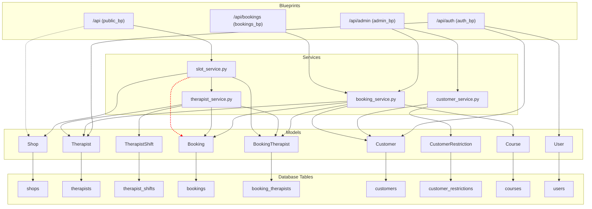

# API Dependency Map

This document illustrates the dependencies between the main components of the API: Blueprints, Services, and Models.

## Dependency Paths

### Blueprint → Service

-   `public_bp` (`/api`)
    -   `slots.py` → `SlotService`
    -   `shops.py` → No service, direct model access.
-   `bookings_bp` (`/api/bookings`)
    -   `routes.py` → `BookingService`
-   `auth_bp` (`/api/auth`)
    -   `__init__.py` → No service, direct model access for authentication.
-   `admin_bp` (`/api/admin`)
    -   Most routes use direct model access for simple CRUD, but more complex operations like creating a booking would likely call `BookingService`. `customers.py` calls `CustomerService`.

### Service → Service

-   `SlotService` → `TherapistService`: `SlotService` delegates the core availability check for each therapist to `TherapistService`.

### Service → Model

-   `SlotService`: Uses `Shop` (to get hours), `Therapist` (to list them), `Booking` and `BookingTherapist` (to show existing bookings).
-   `TherapistService`: Uses `Therapist`, `TherapistShift` (to check schedules), and `Booking`/`BookingTherapist` (to check for conflicts). **This is the core of availability logic.**
-   `BookingService`: The most complex service. It uses `Customer` (eligibility), `Therapist` (locking/assignment), `Booking`, `BookingTherapist`, `BookingService` model, `BookingAddon` (to create the records).
-   `CustomerService`: Uses `Customer` and `CustomerRestriction` to manage the NG List.

### Model → Table

Each model class maps directly to a database table via the `__tablename__` attribute. For example, the `Booking` class in `booking.py` maps to the `bookings` table.
