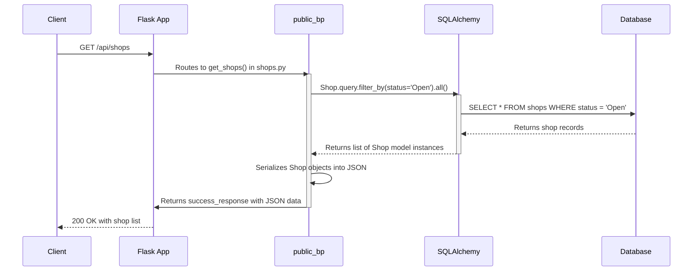

# API Request Flow

This document details how different types of requests flow through the API.

## Flow 1: Search Shops (Public Data Retrieval)

This flow is for fetching public, non-sensitive data. The user or system requests a list of available shops.

**Endpoint**: `GET /api/shops`

### Trace

### File Involvement

1.  **[[spa-booking-api/app/blueprints/public/shops.py]]**:
    -   **Role**: Defines the route and handles the request.
    -   **Function**: `get_shops()`
    -   **Input**: HTTP GET request.
    -   **Output**: JSON response containing a list of shops.
    -   **Logic**: It directly uses the `Shop` model to query the database. For this simple query, a service layer is not used.

2.  **[[spa-booking-api/app/models/shop.py]]**:
    -   **Role**: Represents the `shops` table in the database.
    -   **Input**: Used by SQLAlchemy to construct the query.
    -   **Output**: Instances of the `Shop` class, which are then serialized.

3.  **[[spa-booking-api/app/utils/responses.py]]** (assumed location of `success_response`):
    -   **Role**: A helper function to create a standardized successful JSON response.
    -   **Input**: The data to be included in the response.
    -   **Output**: A Flask `Response` object with a 200 status code and JSON payload.
