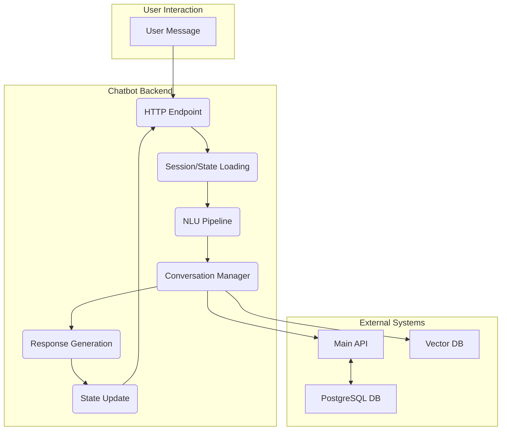

# Chatbot Architecture

This document provides a high-level overview of the chatbot's system architecture. The chatbot is a sophisticated Python application designed to handle user requests for booking massages and answering frequently asked questions.

## Core Components

The chatbot's architecture is modular, with distinct components each handling a specific part of the message processing pipeline.

### Component Responsibilities

1.  **HTTP Endpoint (`[[chatbot/app/main.py]]`)**: Receives incoming user messages via a REST API, initiating the processing pipeline.
2.  **Session/State Loading (`[[chatbot/session/session_manager.py]]`)**: Loads the user's current conversation state from a persistent store (e.g., Redis) or creates a new session.
3.  **NLU Pipeline (`[[chatbot/nlu/nlu_pipeline.py]]`)**: Processes the raw user text to understand its meaning. This involves:
    *   **Intent Classification**: Determining the user's goal (e.g., `book_massage`, `faq`).
    *   **Entity Extraction**: Identifying key pieces of information (e.g., "60 minutes", "Shinjuku").
4.  **Conversation Manager (`[[chatbot/conversation/conversation_manager.py]]`)**: The core of the chatbot. It uses the output from the NLU pipeline and the current conversation state to decide what to do next. This includes:
    *   **Dialogue Policy**: Managing the flow of the conversation.
    *   **Planner**: Deciding which tools to use to fulfill the user's request.
    *   **Tool Execution**: Calling external tools (e.g., an API client to check for available booking slots).
5.  **Response Generation (`[[chatbot/conversation/response_generator.py]]`)**: Constructs the response to send back to the user.
6.  **State Update (`[[chatbot/session/session_manager.py]]`)**: Saves the updated conversation state back to the persistent store.
7.  **HTTP Response**: Sends the generated response back to the user.

## Directory Structure

The chatbot's functionality is organized into the following key directories:

-   `[[chatbot/app/]]`: The web server (FastAPI) that exposes the chatbot's functionality via an HTTP API.
-   `[[chatbot/conversation/]]`: Manages the dialogue flow, state, and response generation.
-   `[[chatbot/nlu/]]`: Handles Natural Language Understanding (intent classification and entity extraction).
-   `[[chatbot/tools/]]`: Contains integrations with external systems, like the main booking API.
-   `[[chatbot/gateway/]]`: Provides a unified interface for accessing external services.
-   `[[chatbot/session/]]`: Manages user session and conversation state persistence.
-   `[[chatbot/schemas/]]`: Pydantic schemas for data validation and serialization.
-   `[[chatbot/models/]]`: Machine learning models for NLU.
-   `[[chatbot/knowledge/]]`: Knowledge base for the FAQ system.
-   `[[chatbot/prompts/]]`: Stores templates for prompts used in response generation.
-   `[[chatbot/recovery/]]`: Mechanisms for handling errors and conversation recovery.
-   `[[chatbot/observability/]]`: Logging, monitoring, and tracing.
-   `[[chatbot/scripts/]]`: Utility scripts for tasks like training models or populating the knowledge base.
