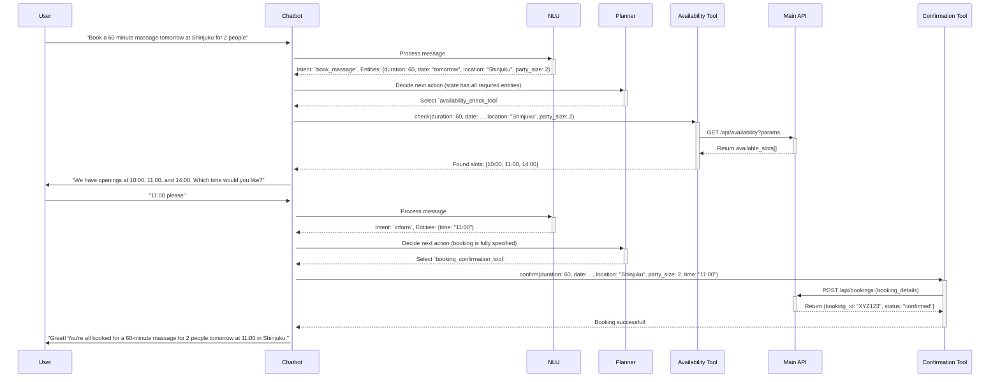

# Chatbot Booking Flow Example

This document traces the path of a specific booking request: `"Book a 60 minute massage tomorrow at Shinjuku for 2 people"`.

## Flow Diagram

## Step-by-Step Breakdown

1.  **Message Reception**: The user sends the message. The `[[chatbot/app/main.py]]` endpoint receives it. The `[[chatbot/session/session_manager.py]]` loads or creates a session. The initial `ConversationPhase` is `START`.

2.  **NLU Processing**: The `[[chatbot/nlu/nlu_pipeline.py]]` processes the text.
    -   **Intent**: Classified as `book_massage`.
    -   **Entities**: The NER model extracts:
        -   `duration`: "60 minute"
        -   `date`: "tomorrow" (which is normalized to a specific date, e.g., `2026-08-13`)
        -   `location`: "Shinjuku"
        -   `party_size`: "2 people"
    -   The `ConversationPhase` is updated to `BOOKING_IN_PROGRESS`.

3.  **Planner Decision (First Pass)**: The `[[chatbot/conversation/conversation_manager.py]]` checks the conversation state.
    -   **Intent**: `book_massage`.
    -   **State**: It has `duration`, `date`, `location`, and `party_size`. However, the exact `time` is missing.
    -   **Action**: The planner determines that to proceed, it needs to know what times are available. It selects the `availability_check_tool`.

4.  **Tool Execution (Availability)**:
    -   The `[[chatbot/tools/availability_check_tool.py]]` is executed.
    -   It calls the main backend API's availability endpoint (`GET /api/availability`) with the extracted entities as query parameters.
    -   The API returns a list of available time slots: `["10:00", "11:00", "14:00"]`.

5.  **Response Generation (Clarification)**:
    -   The `[[chatbot/conversation/response_generator.py]]` receives the list of available slots.
    -   It formats a question to the user: *"We have openings at 10:00, 11:00, and 14:00. Which time would you like?"*
    -   The `ConversationPhase` is set to `AWAITING_INFORMATION` (specifically, the time). The state is saved. The response is sent.

6.  **User Provides Time**: The user replies, "11:00 please".

7.  **NLU Processing (Second Pass)**:
    -   **Intent**: Classified as `inform`. This is a generic intent for when the user is providing information.
    -   **Entities**: The NER model extracts `time`: "11:00".

8.  **Planner Decision (Second Pass)**: The `ConversationManager` reviews the state again.
    -   **State**: The state now contains *all* required entities for a booking: `duration`, `date`, `location`, `party_size`, and `time`.
    -   **Action**: The booking is fully specified. The planner selects the `booking_confirmation_tool`.

9.  **Tool Execution (Confirmation)**:
    -   The `[[chatbot/tools/booking_confirmation_tool.py]]` is executed.
    -   It calls the main backend API's booking creation endpoint (`POST /api/bookings`) with the complete booking details.
    -   The API creates the booking in the database and returns a success response with a `booking_id`.

10. **Response Generation (Confirmation)**:
    -   The `ResponseGenerator` receives the successful booking confirmation.
    -   It formats a final confirmation message: *"Great! You're all booked for a 60-minute massage for 2 people tomorrow at 11:00 in Shinjuku."*
    -   The `ConversationPhase` is updated to `BOOKING_COMPLETE`. The final state is saved, and the response is sent to the user.
