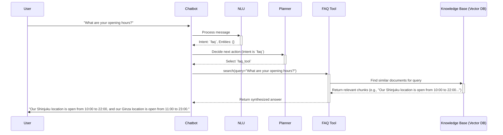

# Chatbot FAQ Flow Example

This document traces the path of a specific FAQ request: `"What are your opening hours?"`.

## Flow Diagram

## Step-by-Step Breakdown

1.  **Message Reception**: The user asks, `"What are your opening hours?"`. The `[[chatbot/app/main.py]]` endpoint receives the message, and the `[[chatbot/session/session_manager.py]]` handles the session. The initial `ConversationPhase` is `START`.

2.  **NLU Processing**: The `[[chatbot/nlu/nlu_pipeline.py]]` processes the text.
    -   **Intent**: The primary intent classifier recognizes this as a question and assigns the `faq` intent.
    -   **Entities**: For this particular query, no specific entities like date or location are extracted.
    -   The `ConversationPhase` is updated to `FAQ_IN_PROGRESS`.

3.  **Planner Decision**: The `[[chatbot/conversation/conversation_manager.py]]` inspects the NLU output.
    -   **Intent**: `faq`.
    -   **Action**: The dialogue policy for the `faq` intent is straightforward: execute a search on the knowledge base. The planner selects the `faq_tool`.

4.  **Tool Execution (FAQ Search)**:
    -   The `[[chatbot/tools/faq_tool.py]]` is executed with the original user query as the input.
    -   The tool connects to the `[[chatbot/knowledge/]]` base, which is a vector database (e.g., PGVector).
    -   It embeds the user's query into a vector and performs a similarity search against the pre-indexed documents in the knowledge base.
    -   The database returns the most relevant text chunk(s), for example, a document containing the sentence: *"Our Shinjuku location is open from 10:00 to 22:00, and our Ginza location is open from 11:00 to 23:00."*

5.  **Response Generation**:
    -   The `[[chatbot/conversation/response_generator.py]]` receives the text retrieved from the knowledge base.
    -   For a direct FAQ, the response is often the retrieved text itself, perhaps with a simple introductory phrase.
    -   The final response is formulated: *"Our Shinjuku location is open from 10:00 to 22:00, and our Ginza location is open from 11:00 to 23:00."*

6.  **State Update and Response**:
    -   The `ConversationPhase` is set back to `START` or `AWAITING_FURTHER_INSTRUCTION`, as the FAQ task is complete.
    -   The state is saved via the `SessionManager`, and the response is sent back to the user.

## Intent Disambiguation: Booking vs. FAQ

The critical step that differentiates the booking and FAQ flows is **Intent Classification** within the `[[chatbot/nlu/nlu_pipeline.py]]`.

-   **Training Data**: The intent classifier is trained on a dataset where utterances are manually labeled.
    -   *"Book a massage"*, *"I need an appointment"*, *"Do you have anything tomorrow?"* → `book_massage`
    -   *"What are your hours?"*, *"How much does it cost?"*, *"Do you offer couple's massages?"* → `faq`
-   **Decision Logic**: When a new message arrives, the classifier compares it to the patterns learned during training.
    -   The presence of booking-related keywords and entities (dates, durations, locations) strongly signals a `book_massage` intent.
    -   The presence of question-like structures (who, what, where, how) and topic-based keywords strongly signals an `faq` intent.
-   **Planner's Role**: The `[[chatbot/conversation/conversation_manager.py]]` simply trusts the intent provided by the NLU pipeline. Its logic is a switch statement based on the intent:
    -   `if intent == 'book_massage'`: Start the booking logic (check for missing entities).
    -   `if intent == 'faq'`: Start the FAQ logic (call the `faq_tool`).
    -   `if intent == 'cancel_booking'`: Start the cancellation logic.
