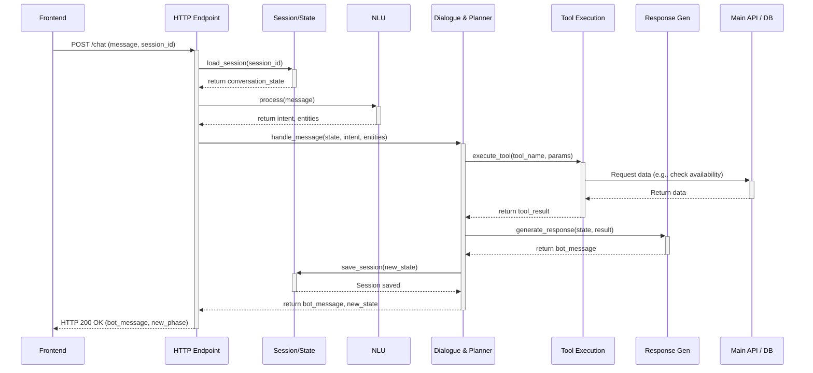

# Chatbot Message Flow

This document outlines the complete lifecycle of a user message as it travels through the chatbot system, from receipt to response.

## Stages of the Message Lifecycle

1.  **User Message → HTTP Endpoint**:
    -   The user sends a message from the frontend.
    -   The FastAPI server in `[[chatbot/app/main.py]]` receives a POST request. The request body contains the user's text and a `session_id`.

2.  **Session/State Loading**:
    -   **File**: `[[chatbot/session/session_manager.py]]`
    -   **Responsibility**: The `SessionManager` uses the `session_id` to retrieve the user's conversation history and current state from a Redis cache. If no session exists, it initializes a new one. The state includes details like extracted entities, previous intents, and the current `ConversationPhase`.

3.  **NLU (Natural Language Understanding)**:
    -   **File**: `[[chatbot/nlu/nlu_pipeline.py]]`
    -   **Responsibility**: The user's raw text is processed to extract meaning.
    -   **Intent Classification**: A model predicts the user's primary goal (e.g., `book_massage`, `faq`, `cancel_booking`). This determines the overall path the conversation will take.
    -   **Entity Extraction**: Named Entity Recognition (NER) models identify and extract structured data from the text, such as dates ("tomorrow"), times, locations ("Shinjuku"), and numbers ("2 people").

4.  **Conversation State Update**:
    -   The newly extracted entities are merged into the `ConversationState`. This state object now represents the most current understanding of what the user wants.

5.  **Dialogue Policy & Planner**:
    -   **File**: `[[chatbot/conversation/conversation_manager.py]]`
    -   **Responsibility**: This is the chatbot's "brain." Based on the current intent and the state (what information is present vs. missing), it decides the next action.
    -   If the intent is **informational** (like `faq`), the planner selects the knowledge base search tool.
    -   If the intent is **transactional** (like `book_massage`), the planner checks which parameters are still needed. If crucial information is missing (e.g., date or time), it sets the `ConversationPhase` to `AWAITING_INFORMATION` and asks a clarifying question. If all required information is present, it selects the appropriate API-calling tool.

6.  **Tool Selection/Execution**:
    -   **File**: `[[chatbot/tools/tool_executor.py]]` and specific tools in `[[chatbot/tools/]]`.
    -   **Responsibility**: The `ToolExecutor` runs the tool selected by the planner. This could be:
        -   `faq_tool`: Queries the vector database for answers.
        -   `availability_check_tool`: Calls the main backend API to check for open massage slots.
        -   `booking_creation_tool`: Calls the main backend API to create the booking.

7.  **Response Generation**:
    -   **File**: `[[chatbot/conversation/response_generator.py]]`
    -   **Responsibility**: Once a tool executes (or if the bot needs to ask a question), this module crafts the response text. It uses predefined templates from `[[chatbot/prompts/]]` and fills them with data from the conversation state or tool results.

8.  **State Update**:
    -   **File**: `[[chatbot/session/session_manager.py]]`
    -   **Responsibility**: The `SessionManager` saves the final state of the conversation (including the bot's response and any phase changes) back to Redis. This ensures the context is maintained for the user's next message.

9.  **HTTP Response → Frontend**:
    -   The FastAPI endpoint sends the generated message and the new `ConversationPhase` back to the frontend in an HTTP response. The frontend UI then updates to display the bot's message and potentially change its state (e.g., show a booking confirmation form).
