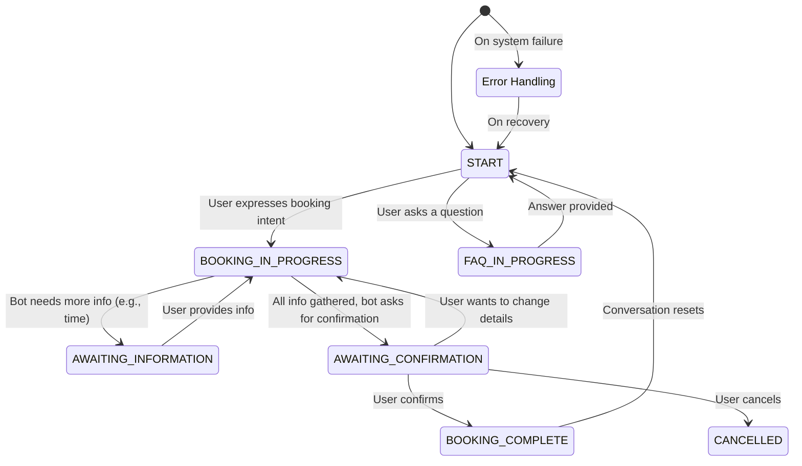

# Conversation State

The Conversation State is the memory of the chatbot. It's a structured object that holds all information about the ongoing interaction with a user. This state is loaded at the beginning of every turn and saved at the end, ensuring continuity.

The primary file responsible for defining this structure is `[[chatbot/schemas/conversation_state.py]]`.

## Core Components of the State

The state object typically contains the following key pieces of information:

1.  **Session ID**: A unique identifier for the user's session.
2.  **User ID**: The ID of the authenticated user, if available.
3.  **Conversation History**: A list of previous user messages and bot responses.
4.  **Extracted Entities**: A dictionary or object holding all the information the NLU pipeline has extracted so far. This is the "form" the chatbot is trying to fill.
    ```json
    {
      "booking_details": {
        "duration": 60,
        "date": "2026-08-13",
        "time": "11:00",
        "location": "Shinjuku",
        "party_size": 2
      }
    }
    ```
5.  **Current Intent**: The last intent classified by the NLU system (e.g., `book_massage`, `faq`).
6.  **Conversation Phase**: A state machine flag that indicates the current stage of the conversation. This is crucial for guiding the dialogue policy.

## The Role of `ConversationPhase`

The `ConversationPhase` is a key field in the state that dictates the chatbot's behavior and the frontend's UI. It is managed by the `[[chatbot/conversation/conversation_manager.py]]` and tells the system what to expect next.

### Key Phases and Their Meanings

-   `START`: The initial state of a new conversation.
-   `BOOKING_IN_PROGRESS`: The user has expressed an intent to book, and the chatbot is gathering information.
-   `AWAITING_INFORMATION`: The chatbot has asked a clarifying question and is waiting for the user to provide a specific piece of information (e.g., the desired time after being presented with options).
-   `AWAITING_CONFIRMATION`: The chatbot has presented a complete summary of the booking and is waiting for the user to confirm (e.g., "Does this look right?").
-   `BOOKING_COMPLETE`: The booking has been successfully created via the API. The conversation can now end or be reset.
-   `FAQ_IN_PROGRESS`: The user has asked a question, and the chatbot is searching the knowledge base.
-   `CANCELLED`: The user has cancelled the current operation.
-   `ERROR`: An unrecoverable error occurred.

### How `ConversationPhase` Changes

The `ConversationManager` is responsible for transitioning between phases.



The `ConversationPhase` is sent back to the frontend with every response. The frontend can use this to conditionally render UI elements, for example:
- If phase is `BOOKING_COMPLETE`, show a success message and a link to the user's bookings.
- If phase is `AWAITING_INFORMATION`, keep the chat input active.
- If phase is `AWAITING_CONFIRMATION`, display the booking summary and "Confirm" / "Cancel" buttons.
