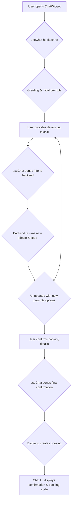
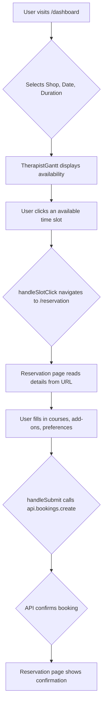

# Frontend Booking Flow

The frontend supports multiple booking flows.

## 1. Chatbot Booking Flow

This flow is handled entirely within the `[[components/chatbot/ChatWidget.tsx]]`.

- **Initiation**: User clicks the chat icon, mounting `[[components/chatbot/ChatWidget.tsx]]`.
- **Engine**: The `[[lib/hooks/useChat.ts]]` hook drives the conversation. It manages the `bookingState`, sends user input to the chatbot API (`[[lib/api.ts]]`), and processes the backend's responses.
- **State**: The `bookingState` is held in the `useChat` hook's memory and is updated progressively by the backend.
- **UI**: `[[components/chatbot/ChatWindow.tsx]]` renders the conversation. It dynamically displays different components like `[[components/chatbot/ShopOptions.tsx]]` or `[[components/chatbot/TimePicker.tsx]]` based on the current `ConversationPhase` returned by the backend.
- **Completion**: The booking is finalized within the chat. The backend returns a `BOOKING_COMPLETE` phase and the final booking details, which are displayed in the chat window. This flow does **not** use `localStorage` or the `/booking` page.

## 2. Gantt Chart Booking Flow

This is a more traditional, visual booking flow.

- **Initiation**: User interacts with the form on `[[app/dashboard/page.tsx]]`.
- **Availability**: The `[[components/TherapistGantt.tsx]]` component shows available slots.
- **Handoff**: Clicking a slot in the Gantt chart navigates the user to `[[app/reservation/page.tsx]]`, passing all selected parameters (`shopId`, `date`, `time`, `duration`) in the URL.
- **Finalization**: The `[[app/reservation/page.tsx]]` is a large, single-page form that gathers all remaining details and calls the `api.bookings.create` function to finalize the reservation. It has its own confirmation UI.

## 3. Standalone Confirmation Flow (Partially Unclear)

This flow uses the `[[app/booking/page.tsx]]` component.

- **Initiation**: This flow begins when there is a `pending_booking` object in `localStorage`. The exact mechanism that *creates* this object is not immediately clear from the analyzed files. It might be from an external source (like a link in an email) or a deprecated part of the application.
- **Process**:
    1. The `[[app/booking/page.tsx]]` loads and reads the `pending_booking` data from `localStorage`.
    2. It presents a multi-step form to the user to confirm the details, add personal information, and select preferences.
    3. It calls `api.bookings.create` to finalize the booking.
    4. If the initial slot is taken, it can suggest and select alternative time slots.
- **State Storage**: Booking state is read from `localStorage` and then managed within the component's React state.
