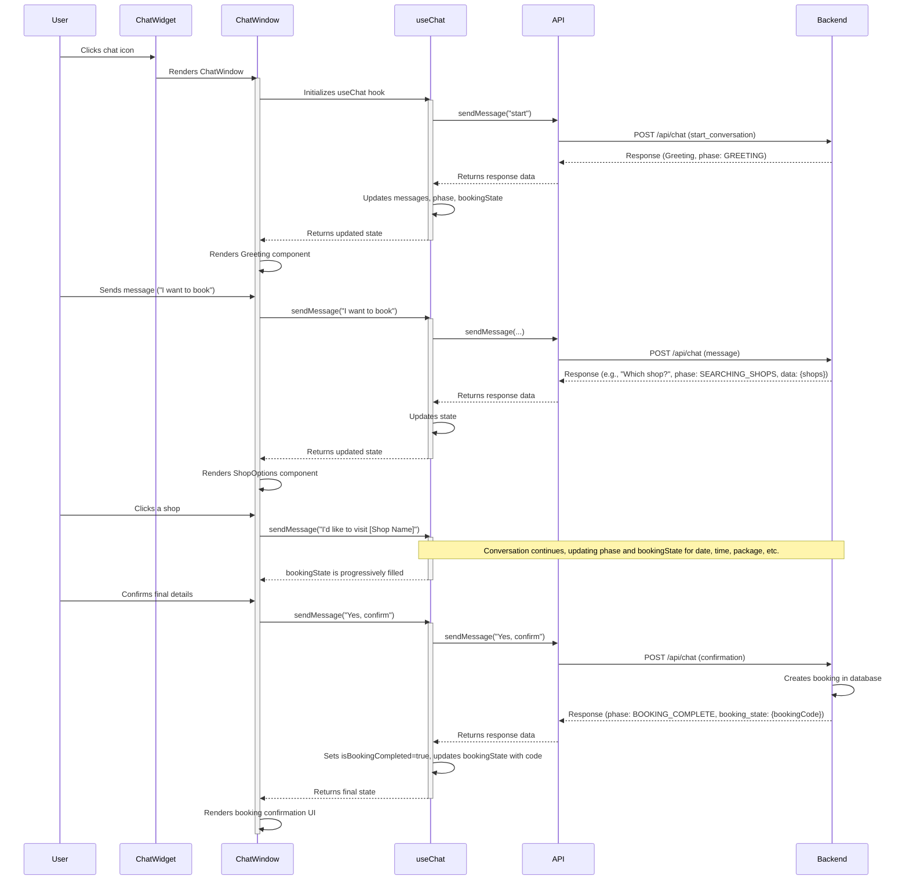

# Frontend Chatbot Flow

The chatbot interaction is self-contained within the components under `[[components/chatbot/]]`.

## Key Components & Files

- **`[[components/chatbot/ChatWidget.tsx]]`**
    - **Role**: The entry point. A floating button that toggles the `ChatWindow`.
- **`[[components/chatbot/ChatWindow.tsx]]`**
    - **Role**: The main container for the chat UI. It orchestrates the rendering of messages and interactive components based on the state from `useChat`.
    - **Input**: `onClose` function.
    - **Dependencies**: `useChat`, `useAuth`, and all the specific option components (`ShopOptions`, `TimePicker`, etc.).
- **`[[lib/hooks/useChat.ts]]`**
    - **Role**: The brain of the chatbot. Manages the entire lifecycle of the chat session.
    - **Output**: An object containing `messages`, `bookingState`, `currentPhase`, `isLoading`, and functions like `sendMessage`.
    - **Dependencies**: `[[lib/api.ts]]`.
    - **Who uses it**: `ChatWindow`.
- **`[[lib/types.ts]]`**
    - **Role**: Defines the core data structures used in the chatbot flow, such as `BookingState`, `ChatRequest`, `ChatResponse`, and `ConversationPhase`.
- **`[[lib/api.ts]]`**
    - **Role**: Provides the `api.chat.sendMessage` function used by `useChat` to communicate with the backend chatbot service.

## Data Flow: User Message to UI Update

1.  **User Action**: The user types a message or clicks a button in an interactive component (e.g., `DateOptions`).
2.  **`ChatWindow` Handler**: An event handler in `ChatWindow` (e.g., `handleDateSelect`) is triggered.
3.  **`sendMessage`**: The handler calls the `sendMessage` function from the `useChat` hook, often formatting the user's choice into a natural language string (e.g., `"Tomorrow"`).
4.  **API Call**: `useChat` constructs a `ChatRequest` object and sends it to the backend via `api.chat.sendMessage`.
5.  **Backend Processing**: The backend's chatbot logic processes the message, updates its internal state machine for the session, and decides the next step.
6.  **API Response**: The backend returns a `ChatResponse` object containing the next message for the user, the new `ConversationPhase`, and the updated `booking_state`.
7.  **State Update**: `useChat`'s `handleBackendResponse` function processes this response, updating its internal state (`messages`, `currentPhase`, `bookingState`).
8.  **React Re-render**: The state update in `useChat` triggers a re-render of `ChatWindow`.
9.  **UI Update**: `ChatWindow`'s rendering logic checks the new `currentPhase` and `bookingState` and displays the appropriate message and/or interactive component.
