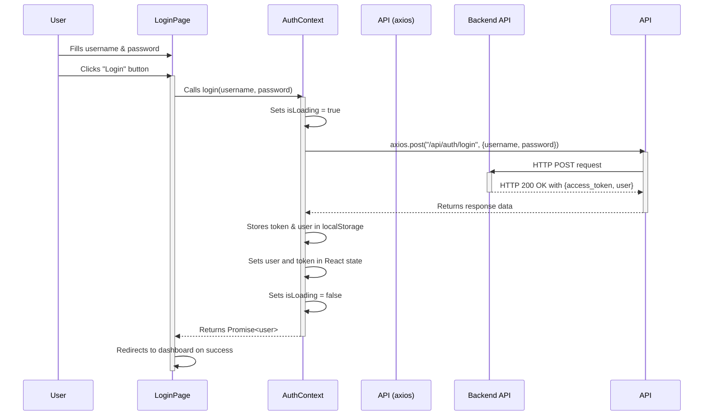

# Frontend Request Flow

This document describes the general pattern for how data flows from a user interaction to an API request and back to a UI update. We will use the **Login Flow** as a specific example.

## General Pattern

1.  **UI Component (`[[app/login/page.tsx]]`)**:
    - **Role**: Renders the form and captures user input.
    - **Action**: An event handler (e.g., `onSubmit`) is triggered by a user action (e.g., clicking a button).

2.  **Context or Hook (`[[contexts/AuthContext.tsx]]`)**:
    - **Role**: Manages application-wide state and contains the logic for making API calls. This decouples the component from the direct implementation of the API call.
    - **Action**: The component's event handler calls a function provided by the context (e.g., `login(username, password)`).

3.  **API Layer (`[[lib/api.ts]]`)**:
    - **Role**: Centralizes API call definitions. It configures a client (like `axios`) with base URLs and headers. This makes it easy to manage authentication tokens and other common request parameters.
    - **Action**: The function in the context/hook calls a specific function from the API layer (e.g., `api.auth.login(...)` which is a pre-configured `axios.post` call).

4.  **Backend API**:
    - **Role**: The external server that processes the request and returns data.

5.  **UI Update**:
    - **Via State Change**: The context/hook receives the data from the API layer. It updates its internal React state with this new data.
    - **React Re-renders**: The state change triggers a re-render of any components that consume the context/hook.
    - **Display**: The components now display the new data.

## Booking State Storage

- **In-Memory (Chatbot Flow)**: During the chatbot booking flow, the `bookingState` is held in memory within the `[[lib/hooks/useChat.ts]]` hook. It is progressively built by responses from the backend and is lost if the page is reloaded.

- **URL (Gantt Chart Flow)**: The initial booking parameters (shop, date, time) are passed from the `[[app/dashboard/page.tsx]]` to the `[[app/reservation/page.tsx]]` via URL query parameters. The `reservation` page then holds the complete state in React component state until the booking is submitted.

- **`localStorage` (Confirmation Flow)**: The `[[app/booking/page.tsx]]` is explicitly designed to read a `pending_booking` object from `localStorage`. This is how it receives its initial state. The source of this `localStorage` entry is not part of the main user flows discovered so far.
